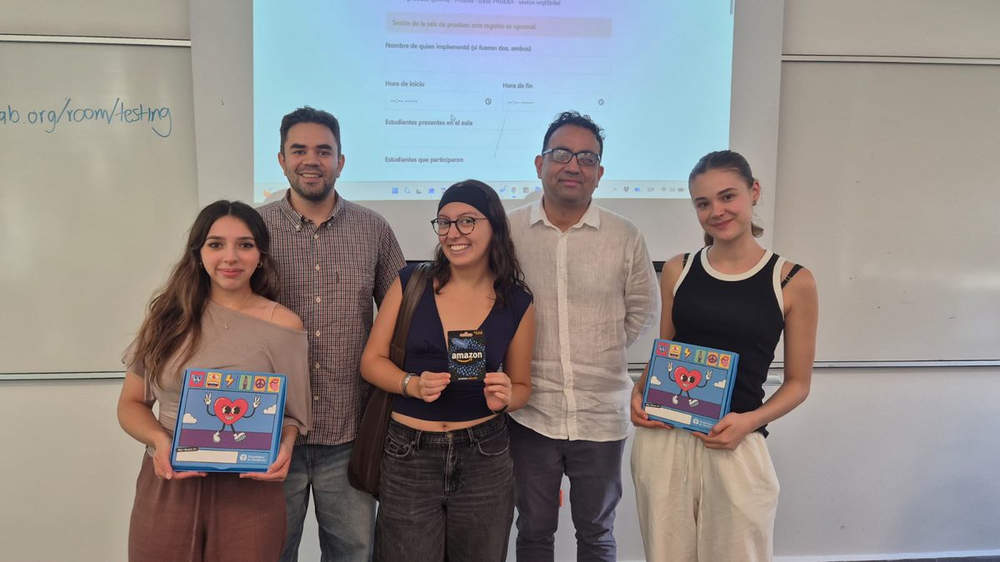

About

<h2>About my work</h2>

My research lies in applied microeconomics, with a focus on public economics and market interventions.

Applied microeconomics · Experimental economics · Public economics · Political economy

I use laboratory and field experiments, together with observational data, to study real-world economic problems and derive policy-relevant insights.

I received my Ph.D. in Economics from the Interdisciplinary Center for Economic Science at George Mason University in December 2023.

I am co-founder and deputy director of the <a href="https://beer-lab.org/en/">BEER Lab</a>, the Behavioral and Experimental Economics Research Lab at Tecnológico de Monterrey.

News

<h2>Recent</h2>

<article>

Working paper · October 2026

<h3><a href="https://www.stanislaomaldonado.org/documents/research/tackling-biased-beliefs.pdf">Tackling Biased Beliefs to Foster Women’s Entry into Economics</a></h3>

With Stanislao Maldonado, Elvira Naranjo and Joana Chapa.

</article>
<article>

Teaching · Fall 2026

<h3>De microincentivos a macroresultados and Economía conductual</h3>

Two courses this semester at Campus Monterrey.

</article>
<article>

Working paper · 2026

<h3><a href="https://publications.iadb.org/en/discretionary-procurement-flexibilization-efficiency-and-rent-seeking-evidence-chile-during-covid">Procurement flexibilization and rent-seeking in Chile during COVID-19</a></h3>

IDB Working Paper Series, with Anastasiya Yarygina-Udovenko and Gabriel Villalba Ortega.

</article>

Research
<h2>Selected papers</h2>

<a class="more" href="research">All research →</a>

<article class="paper compact">

<b>2021</b>Published

Public Good Provision and Property Tax Compliance: Evidence from a Natural Experiment

with Paul E. Carrillo and Carlos Scartascini · <em>Journal of Public Economics</em>

<a href="https://doi.org/10.1016/j.jpubeco.2021.104422">Read paper ↗</a>

</article>

<article class="paper compact">

<b>2023</b>Revise and resubmit

Price Distortions and Hoarding: An Experiment

with César Martinelli · <em>Journal of Economic Behavior &amp; Organization</em>

<a href="https://ssrn.com/abstract=4654570">Read paper ↗</a>

</article>

<article class="paper compact">

<b>2026</b>Working paper

Tackling Biased Beliefs to Foster Women’s Entry into Economics: Experimental Evidence from Mexico

with Stanislao Maldonado, Elvira Naranjo and Joana Chapa

<a href="https://www.stanislaomaldonado.org/documents/research/tackling-biased-beliefs.pdf">Read paper ↗</a>

</article>

<section class="feature">

BEER Lab

<h2>Behavioral and Experimental Economics Research Lab</h2>

I co-founded the lab with Stanislao Maldonado at Tecnológico de Monterrey. The lab runs economic experiments, publishes a working paper series, and offers training in experimental methods.

<a href="https://beer-lab.org/en/">Visit the lab →</a> &nbsp; <a href="projects">Projects →</a>

</section>
