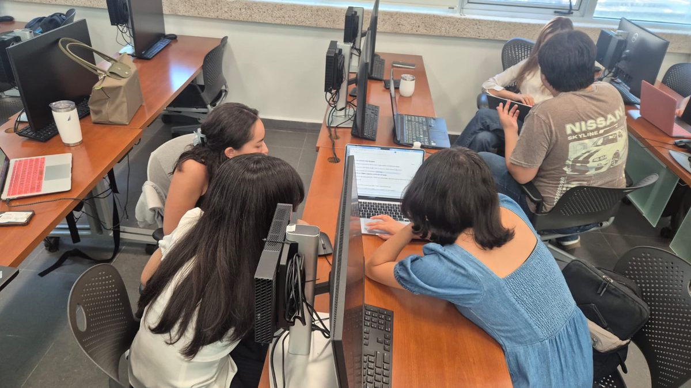
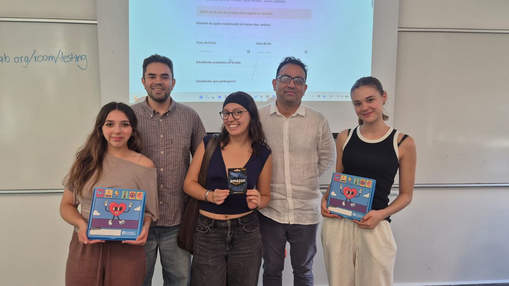

<b>Research laboratory</b> Co-founder and Deputy Director Tecnológico de Monterrey

<h2>Behavioral and Experimental Economics Research Lab (BEER Lab)</h2>

I co-founded the lab with <a href="https://www.stanislaomaldonado.org/">Stanislao Maldonado</a> and serve as its deputy director. The lab runs economic experiments, publishes a working paper series, and offers training in experimental methods.

<a href="https://beer-lab.org/en/">Lab website</a> · <a href="https://beer-lab.org/en/research/">Research at the lab</a>

<b>Teaching platform</b> Contributor BEER Lab

<h2>Classroom Experiments</h2>

A collection of about 185 experimental economics games that instructors can run in class from a browser, with guides that are free to reuse. I am one of the contributors to the collection.

<a href="https://teaching.beer-lab.org/en/">Browse the games</a> · <a href="https://teaching.beer-lab.org/guia/en/">Instructor guide</a>

<figure><figcaption>Teams working through a session in the computer lab.</figcaption></figure>
<figure><figcaption>Prizes after a session.</figcaption></figure>

